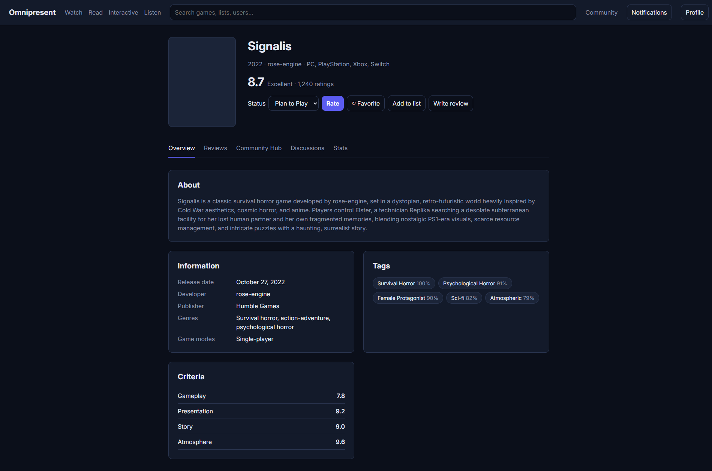
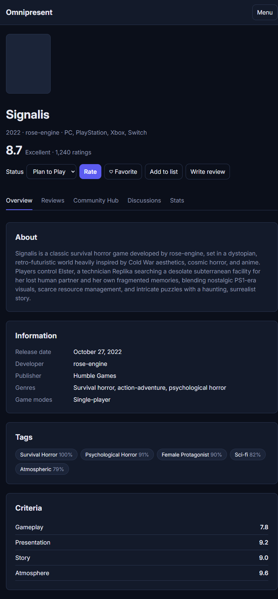
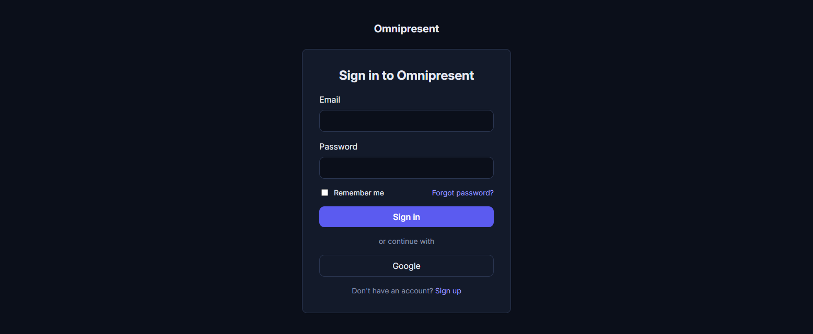

# Omnipresent

**Find media by its strengths, not just its popularity.**

> 🚧 Work in progress. The project is currently a static HTML/CSS/JavaScript prototype. The full-stack app (Next.js + Spring Boot) is the next step.

## About

Omnipresent is a platform for tracking, rating and discovering all kinds of media: video games, movies, series, anime, books, manga and music. It launches with video games first.

Most sites let you search by genre and popularity. Omnipresent lets you search by what a game does well: every game is rated on criteria that fit it (Story, Atmosphere, Combat...), so you can look for "Atmosphere ≥ 9 and Story ≥ 8.5" and find hidden gems right next to famous titles.

Key ideas:

- **Criteria-based ratings.** One overall score is enough; detailed criteria are optional. Each game gets the criteria that fit it, based on its tags.
- **Search by criteria.** Filter by minimum scores, with fair ranking between popular and obscure titles.
- **Community tags with relevance.** Tags are voted by users, shown as percentages and shared across all media types.
- **Monetization rated separately.** A great game with aggressive microtransactions is neither hidden nor praised without context.

## Screenshots

Game page (desktop):



Game page (mobile, 375px):



Sign-in page:



*Scores, ratings and tag percentages shown are sample data.*

## Progress

- [x] Static prototype: navbar with category menus, sign-in page, game page
- [x] Responsive layout (desktop and 375px mobile) and keyboard accessibility
- [x] Interactive rating slider and mobile navigation menu (vanilla JavaScript)
- [ ] Next.js frontend with mock data
- [ ] Spring Boot REST API and PostgreSQL database
- [ ] Accounts: email and password (JWT), then Google sign-in
- [ ] Game library and overall ratings
- [ ] Criteria-based ratings and radar chart
- [ ] Search by criteria
- [ ] Public launch

## Tech stack

**Current prototype:** HTML, CSS (custom properties, Flexbox, Grid, media queries), vanilla JavaScript.

**Planned:**

| Area | Technologies |
|---|---|
| Frontend | TypeScript, React, Next.js (App Router), Tailwind CSS |
| Backend | Java, Spring Boot, Spring Data JPA, Spring Security (JWT) |
| Database | PostgreSQL, Flyway migrations |
| Testing | JUnit 5, Mockito, Testcontainers, Playwright |
| DevOps | Docker, Docker Compose, GitHub Actions; Vercel (frontend), Railway or Render (backend) |

## Running the prototype

No installation needed: clone the repository and open `prototype/index.html` in a browser.

## Project structure

```
prototype/          static HTML/CSS/JS prototype
docs/screenshots/   images used in this README
```